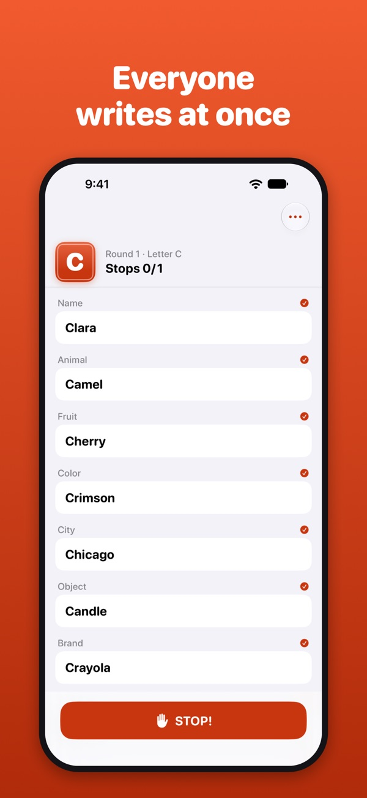

# Stop

Stop, the classic word game, for iPhones in the same room. No internet, no accounts, no ads.

Stop (also called Adedanha or Adedonha) is coming to the App Store as **Stop: Multiplayer Party Game**. This source is open
so that anyone can see how it works, reuse the code under the [MIT license](LICENSE), report problems, and
contribute improvements.



## Features

- Host a game on one iPhone; friends nearby see it and join with one tap. No codes, no accounts.
- Works on the same Wi-Fi network, or with no router at all (peer-to-peer Wi-Fi), with no internet connection.
- Built-in categories in English and Brazilian Portuguese, plus your own custom categories (remembered for
  future games), in any order. The next game you host starts with the categories of the last one.
- A random letter every round (all 26 letters, no repeats until every letter has been used), then a 3-2-1
  countdown.
- STOP locks every phone at the same instant. The host chooses how many stops end a round, and can allow
  giving up on a hard letter.
- Score together: everyone sees all the answers and everyone's points, and each player scores their own
  (10 unique, 5 repeated, 0 blank). Picks can be changed until the host moves on to the next category, and the
  host can go back to fix a score until the next round starts. The app never judges answers.
- Round results with running totals, and final standings with a celebration for the winner.
- Survives normal phone life: locking the screen, a phone call, switching apps, even the app being closed.
  Players rejoin automatically, and the answers they've typed are kept.
- Haptics, optional sounds, VoiceOver labels, Dynamic Type, Reduce Motion, dark mode.

## How to play

1. One player taps **Host a game**, picks the categories and the rules, and waits in the lobby.
2. Everyone else taps **Join a game** and picks the host's game from the list.
3. The host taps **Start**. A letter appears, then a 3-2-1 countdown.
4. Everyone fills in one word per category starting with that letter.
5. When you've filled every category, tap **STOP**. Once enough players have stopped, every phone locks.
6. Go through the categories together: each player gives their own answer 10 (nobody else wrote it),
   5 (someone else wrote the same) or 0 (blank or wrong). Everyone sees everyone's points; once all have
   scored, the host taps **Next category** (**See results** after the last one). To fix a score, the host taps
   **Previous category** (or **Back to scoring** on the round results).
7. See the round ranking and totals. The host starts the next round or ends the game.

## Requirements

- iPhone with iOS 27 or later.
- All players on the same Wi-Fi network, or near each other with Wi-Fi turned on (no network needed to be
  joined). Guest or isolated (client-isolation) networks may block it.
- Local Network permission granted (Settings > Privacy & Security > Local Network).
- To build: macOS with Xcode 27 and the iOS 27 simulator runtime.

## Building

1. Clone the repository.
2. Open `Stop.xcodeproj` and run the `Stop` scheme on a simulator. No signing setup is needed; use
   Practice with bots or mock mode (below) to play without a second device.

**Practice with bots (Debug builds only).** A build from Xcode (the Debug configuration) has a third button on
Home, **Practice with bots**: a solo game on one phone against 1–5 computer players, at Relaxed, Normal or Fast
speed, with no network at all. It's for development and testing; Release builds (TestFlight and the App Store)
leave it out.

To run it on an iPhone, Xcode signs with the maintainer's team, which is set on the targets. Building under your
own team? Pick it in **Signing & Capabilities** and use a bundle identifier of your own, but don't commit those
changes. Shared build settings (bundle ID, version, deployment target, Swift settings) live in
`Config/Project.xcconfig`.

## Testing

```sh
tools/test.sh            # everything: unit tests, then UI tests (default)
tools/test.sh unit       # StopKit package tests (seconds, on the Mac) + the app's unit tests (StopTests) on a simulator
tools/test.sh ui         # the app's UI tests (StopUITests) on a simulator (several minutes)
tools/test.sh ui -only-testing:StopUITests/PracticeUITests   # extra args go to xcodebuild
```

`tools/test.sh` uses the `iPhone 17` simulator, or the first available iPhone if that isn't installed. The
package tests are where most of the logic is tested and finish quickly; the app tests build the app and drive a
whole game in the simulator with XCUITest, so they take most of the time. CI (`.github/workflows/ci.yml`) runs
both on pushes and pull requests to `main`.

The UI tests (`StopUITests`) cover a full two-round game, a force-ended round, a relaunch that restores
the draft, practice with bots in both languages, typing latency (`XCTClockMetric`, under 3 s for 30
characters) and an accessibility audit of every main screen.

`tools/check_release.sh` builds the Release configuration and checks that Practice with bots (Debug-only) left
no trace in the binary; run it before archiving for TestFlight.

`tools/screenshots.sh` makes the App Store and website screenshots: it runs `ScreenshotTests` on temporary
iPhone 17 Pro Max and iPhone 17 simulators in English and Portuguese, then `tools/frame_screenshots.swift`
captions them into `appstore/screenshots/` and `docs/images/screens/`. Regenerate them only when the UI they
show changes: the PNGs are large, and every run adds them to the repository's history again.

Multi-iPhone behaviour (routers, locking, calls, force-quits) is checked by hand with
[`docs/device-test-checklist.md`](docs/device-test-checklist.md).

### Mock mode and launch arguments

Set these in the scheme (Product > Scheme > Edit Scheme > Run > Arguments) or pass them to `tools/run-sim.sh`.
They work in Debug builds only (development, UI tests, screenshots); a Release build ignores them:

| Argument | Effect |
|---|---|
| `-mockGame` | Starts a game against bots "Ana", "Bia" and "Caio" over an in-memory connection, with no network. The bots stop only after you do, so tests control the round. The game is saved like a hosted one, so without a wipe a relaunch comes back to it. |
| `-mockSeed <n>` | With `-mockGame`: a repeatable game (the same letters and bot answers every time, quick bots), for screenshots. |
| `-resetState` | Wipes the on-device store at launch. |
| `-keepState` | Keeps the store under `-uiTesting` (for UI tests that relaunch the app; `-resetState` still wipes). |
| `-playerName <name>` | Sets the display name and skips onboarding. |
| `-uiTesting` | Clean state, no sounds, and Reduce Motion forced on (views read a custom `\.reduceMotion` value) so XCUITest never waits on looping animations. |

For example: `tools/run-sim.sh "iPhone 17" build/shot.png -mockGame -playerName Gui`.

## Architecture

| Path | Contents |
|---|---|
| `Packages/StopKit/` | Swift package with all game logic, networking and sessions; no UI code |
| `  StopCore` | Pure models and rules: players, settings, letter picker, stop rule, scoring and ranking, and the host's game engine: a mutating reducer, `GameEngine.apply(_:from:to:using:)`, that changes the `GameState` in place or throws a `GameError` (no effects; the session layer does the I/O) |
| `  StopNetworking` | `Transport` protocol; `NWTransport` (Network.framework, Bonjour `_stopgame._tcp`, peer-to-peer Wi-Fi, length-prefixed JSON frames) and an in-memory transport with fault injection |
| `  StopSession` | Host and client sessions: wire protocol, heartbeat and presence, acknowledgements and retries, reconnection, snapshot resync, persistence |
| `  StopSimulation` | Bot players and in-memory games, used by Practice with bots and mock mode (Debug builds) and tests |
| `  StopTestSupport` | Test clock, seeded random numbers and other test helpers |
| `Stop/`, `StopTests/`, `StopUITests/` | SwiftUI app, its unit tests and its UI tests: views, view models, localization (`Localizable.xcstrings`, en and pt-BR), haptics and sounds, on-device store |
| `Config/` | Shared build settings; your local signing settings |
| `docs/` | Website and privacy policy (GitHub Pages), device test checklist, design spec |
| `appstore/` | App Store publishing guide and screenshots |
| `tools/` | Test, simulator, screenshot and listing-check scripts |

**Host-authoritative snapshots.** The host phone runs the game engine and is also a player: its own client
talks to the engine in-process through the same interface as everyone else. Clients send intents (join, stop,
give up, answers, scores), each with an ID so retries are safe. The host validates and applies them, then sends
every client a full snapshot of the game with an increasing version number; clients ignore older snapshots.
Other players' answers are left out of snapshots until scoring starts. Typing never touches the network or the
shared game model: answers stay in the field's local state and are saved on the device in the background.

**Reconnection.** Both sides send a heartbeat every second; a player silent for 3 seconds is shown as away to
everyone. When an app goes to the background it says so right away. On return, or after a relaunch, the
client looks for the same game ID again and reconnects (after 0.25 s, 0.5 s, 1 s, then every 2 s), sending its
player ID and last snapshot version; the host replies with the current snapshot. The host saves the whole game
on every change, so if the host app is closed and reopened it restores the game and advertises it again, and
everyone rejoins. Clients save their in-progress answers per game and round, so the answers you've typed come back with you.

```
            Host iPhone                              Each player's iPhone
 +-------------------------------+            +-------------------------------+
 | SwiftUI app                   |            | SwiftUI app                   |
 |   | (in-process local client) |            |   |                           |
 | StopSession: host session     |  intents   | StopSession: client session   |
 |   StopCore game engine     <--+------------+-- answers, stops, scores      |
 |   game saved on every change  |  snapshots |   drafts saved per round      |
 |                            ---+------------+->                             |
 | StopNetworking: NWTransport   |            | StopNetworking: NWTransport   |
 +---------------+---------------+            +---------------+---------------+
                 |    TCP over Wi-Fi or peer-to-peer Wi-Fi     |
                 +---- Bonjour _stopgame._tcp, 1 s heartbeats -+
```

Practice with bots (Debug builds) runs the same host and client code over the in-memory transport, so it
never touches the network and never shows the Local Network prompt.

## Privacy

The app collects no data. There is no analytics, advertising, tracking or crash reporting, and no third-party
code. It only talks to other iPhones in the game on your local network; names, answers and scores never leave
it. While you host, your display name is shown to nearby phones that open Join a game (it's in the game's
Bonjour advertisement), so friends can find your game. See the [privacy policy](docs/privacy/index.md).

## Contributing and feedback

Bug reports, ideas and pull requests are welcome. See [CONTRIBUTING.md](CONTRIBUTING.md). The maintainer
reviews every pull request and decides what goes into each App Store release. Report problems in
[GitHub issues](https://github.com/guilhermechapiewski/stop-multiplayer-game-app/issues).

## License

[MIT](LICENSE).
