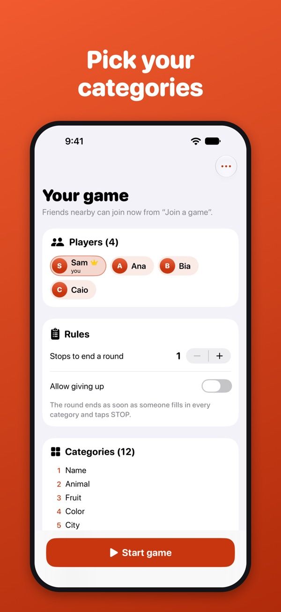
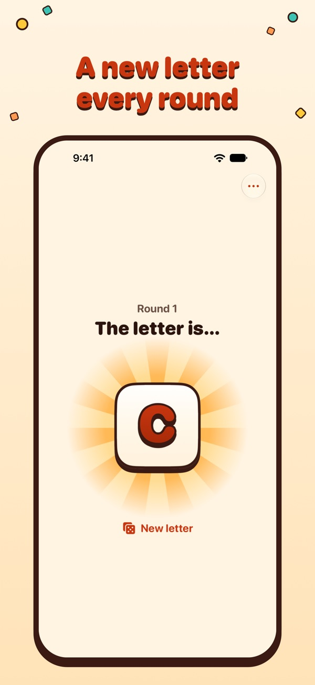
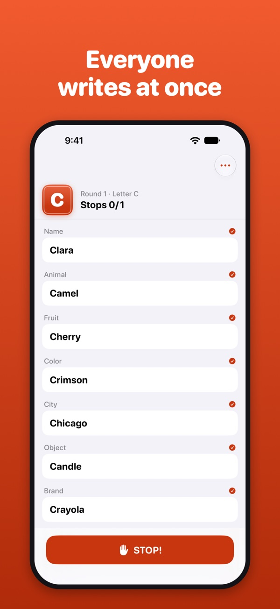
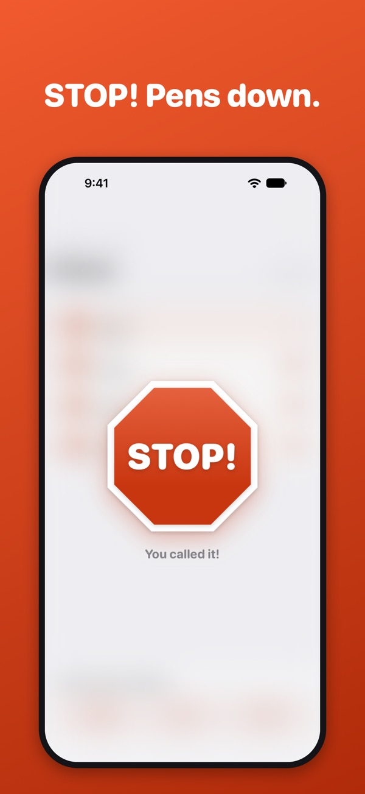
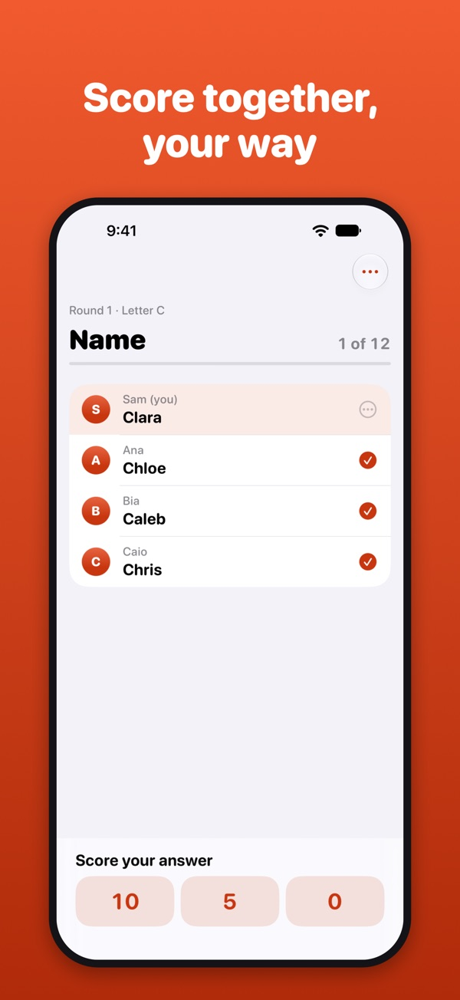
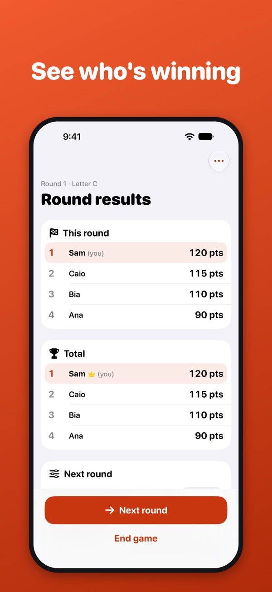
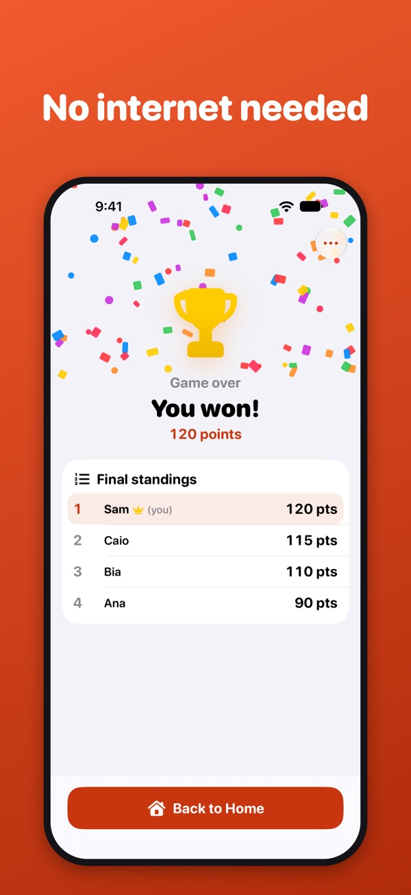

[Em português](pt/)

# Stop

**The classic word game, for iPhones in the same room.**
No internet, no accounts, no ads. Free, with no in-app purchases and no tracking.

  

  
  
  
  
  
  
  

## How it works

1. **The host picks the categories**: Name, Animal, Fruit, Country... or your own.
2. **A letter appears**, then a 3-2-1 countdown.
3. **Everyone writes at once**, one word per category starting with that letter.
4. **STOP!** When enough players have stopped, every phone locks at the same moment.
5. **Score together.** Everyone sees all the answers and gives their own 10, 5 or 0, and everyone's points
   show on every phone. When all have scored, the host moves on to the next category. The app never judges:
   that's up to the table.

After each round you see the ranking and the totals. Play as many rounds as you like.

## Play anywhere

Everyone just needs to be on the same Wi-Fi, or simply near each other with Wi-Fi turned on: no router and no
internet needed. One phone hosts and the others join with a tap, with no codes or accounts. If someone takes a
call, locks their phone or the app is closed, they rejoin by themselves, and the answers they've typed come back with them.

The app is in English and Brazilian Portuguese, and each phone uses its own language in the same game.

## Private by design

Stop collects no data. It shows no ads and has no accounts. It only talks to the other phones in your game,
on your local network, and names, answers and scores never leave it. While you host, your display name is
shown to nearby phones that open Join a game, so friends can find your game. [Privacy policy](privacy/).

## Help and feedback

Found a bug or have an idea? [Open an issue on GitHub](https://github.com/guilhermechapiewski/stop-multiplayer-game-app/issues).

## Open source

Stop is free and open source under the MIT license:
[github.com/guilhermechapiewski/stop-multiplayer-game-app](https://github.com/guilhermechapiewski/stop-multiplayer-game-app).
