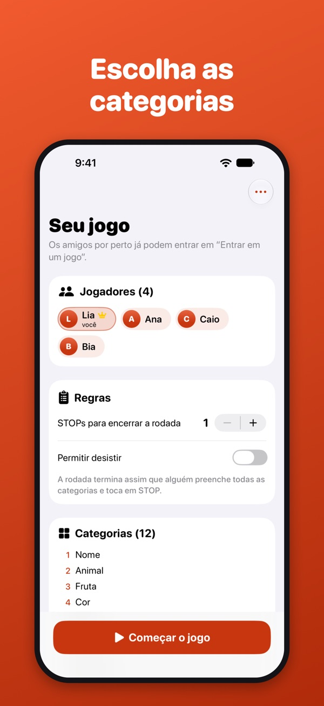
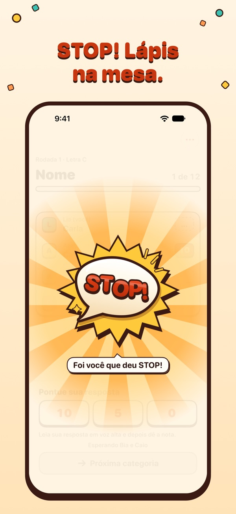
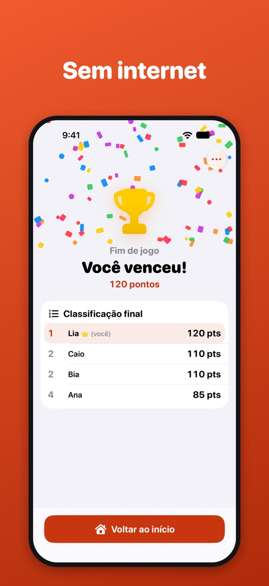

[In English](../)

# Stop

**O clássico jogo de palavras, para iPhones na mesma sala.**
Sem internet, sem contas, sem anúncios. Grátis, sem compras no app e sem rastreamento.

<!-- badge: enable after approval, see appstore/PUBLISHING.md step 11

  

-->

**Em breve na App Store.** Para iPhone.

  
  
  
  
  
  
  

## Como funciona

1. **Quem cria o jogo escolhe as categorias**: Nome, Animal, Fruta, País... ou as suas.
2. **Aparece uma letra**, e depois uma contagem 3-2-1.
3. **Todo mundo escreve junto**, uma palavra por categoria começando com essa letra.
4. **STOP!** Quando jogadores suficientes dão STOP, todos os celulares travam no mesmo instante.
5. **Pontuem juntos.** Todo mundo vê todas as respostas e dá a própria nota: 10, 5 ou 0. O app nunca julga:
   quem decide é a turma.

Depois de cada rodada aparecem a classificação e o placar geral. Joguem quantas rodadas quiserem.

**Ninguém para jogar agora?** Toque em **Treinar com robôs** para jogar sozinho contra 1 a 5 jogadores do
computador. É um bom jeito de aprender o jogo, e funciona em qualquer lugar, até no Modo Avião.

## Jogue em qualquer lugar

Basta todo mundo estar no mesmo Wi-Fi, ou só perto um do outro com o Wi-Fi ligado: não precisa de roteador
nem de internet. Um celular cria a partida e os outros entram com um toque, sem códigos nem contas. Se alguém
atender uma ligação, bloquear o celular ou o app for fechado, a pessoa volta sozinha para a partida, e as
respostas que ela já tinha escrito voltam junto.

O app está em português do Brasil e em inglês, e cada celular usa o próprio idioma na mesma partida.

## Privacidade de verdade

O Stop não coleta nenhum dado. Não mostra anúncios e não tem contas. Ele só conversa com os outros celulares
da sua partida, na sua rede local, e nomes, respostas e pontos nunca saem dela.
[Política de privacidade](privacidade/).

## Ajuda e sugestões

Encontrou um problema ou tem uma ideia? [Abra um relato (issue) no GitHub](https://github.com/guilhermechapiewski/stop-multiplayer-game-app/issues).

## Código aberto

O Stop é grátis e de código aberto, sob a licença MIT:
[github.com/guilhermechapiewski/stop-multiplayer-game-app](https://github.com/guilhermechapiewski/stop-multiplayer-game-app).
