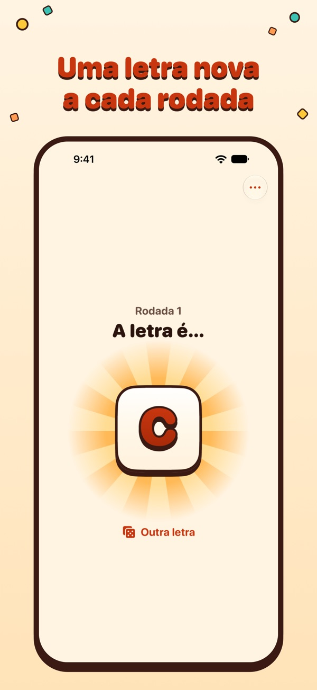
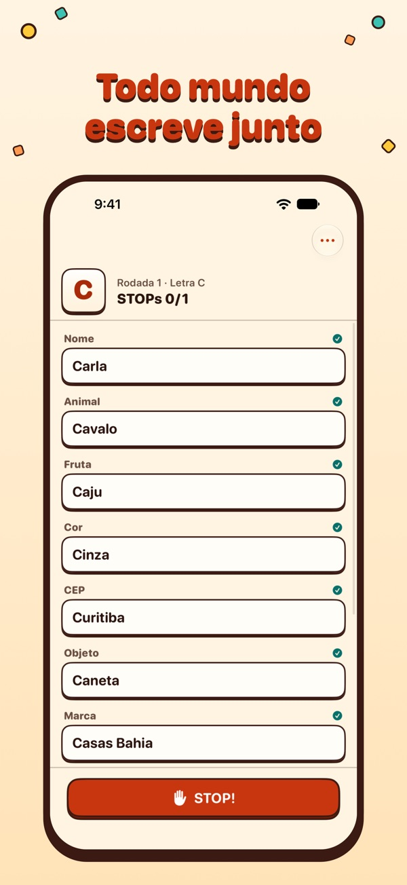
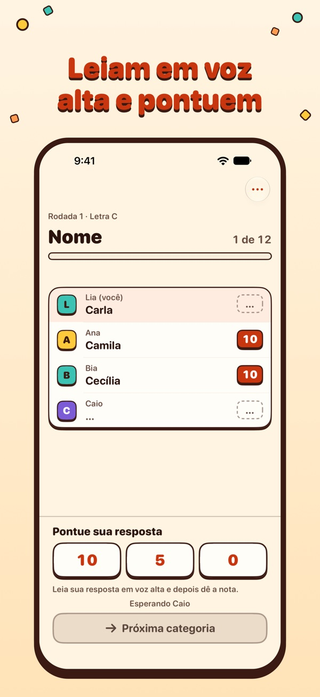
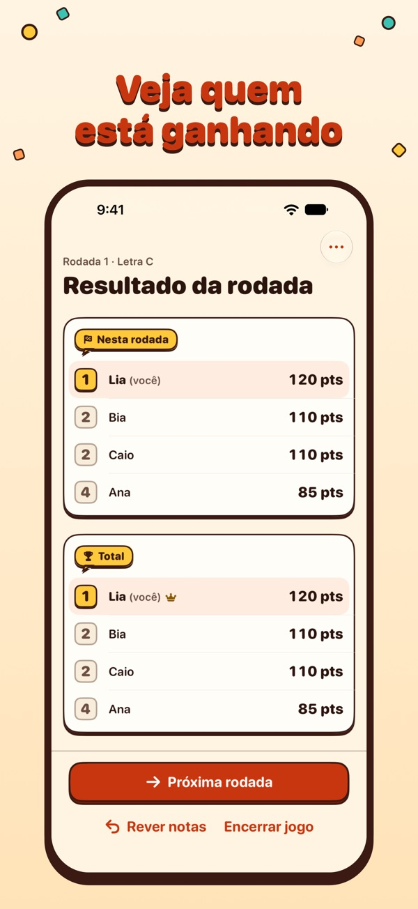

[In English](../)

# Stop

**O clássico jogo de palavras, para iPhones na mesma sala.**
Sem internet, sem contas, sem anúncios. Grátis, sem compras no app e sem rastreamento.

  

  
  
  
  
  
  
  

## Como funciona

1. **Quem cria o jogo escolhe as categorias**: Nome, Animal, Fruta, País... ou as suas.
2. **Aparece uma letra**, e depois uma contagem 3-2-1.
3. **Todo mundo escreve junto**, uma palavra por categoria começando com essa letra.
4. **STOP!** Quando jogadores suficientes dão STOP, todos os celulares travam no mesmo instante.
5. **Pontuem juntos.** Cada pessoa lê a sua resposta em voz alta e dá a nota: 10, 5 ou 0; ela aparece com os
   pontos em todos os celulares assim que recebe a nota (ou liguem o modo silencioso para ver todas as
   respostas de uma vez). Quando todo mundo pontuou, quem criou o jogo passa para a próxima categoria. O app
   nunca julga: quem decide é a turma.

Depois de cada rodada aparecem a classificação e o placar geral. Joguem quantas rodadas quiserem.

## Jogue em qualquer lugar

Basta todo mundo estar no mesmo Wi-Fi, ou só perto um do outro com o Wi-Fi ligado: não precisa de roteador
nem de internet. Um celular cria a partida e os outros entram com um toque, sem códigos nem contas. Se alguém
atender uma ligação, bloquear o celular ou o app for fechado, a pessoa volta sozinha para a partida, e as
respostas que ela já tinha escrito voltam junto.

O app está em português do Brasil e em inglês, e cada celular usa o próprio idioma na mesma partida.

## Privacidade de verdade

O Stop não coleta nenhum dado. Não mostra anúncios e não tem contas. Ele só conversa com os outros celulares
da sua partida, na sua rede local, e nomes, respostas e pontos nunca saem dela. Enquanto você hospeda uma
partida, o seu nome aparece para os celulares por perto que abrem Entrar em um jogo, para que os amigos
encontrem a sua partida. [Política de privacidade](privacidade/).

## Ajuda e sugestões

Encontrou um problema ou tem uma ideia? [Abra um relato (issue) no GitHub](https://github.com/guilhermechapiewski/stop-multiplayer-game-app/issues).

## Código aberto

O Stop é grátis e de código aberto, sob a licença MIT:
[github.com/guilhermechapiewski/stop-multiplayer-game-app](https://github.com/guilhermechapiewski/stop-multiplayer-game-app).
